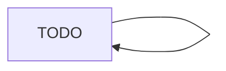
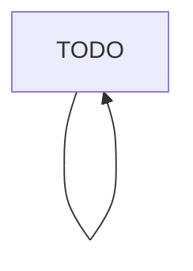

# Change specification

Replace every placeholder with specific content before Tier 2 entry.

## Problem
TODO: Describe the problem and its affected users or boundaries.

## Minimum change
TODO: Describe the smallest approved change and exclusions.

For readable evidence runs, author tagged Gherkin in `.a2e/specs/` and link scenario IDs to native checks and declared component/connection IDs in the v2 packet. The prose is the behavior contract; runners supply separate verification, not automatic translation or proof of coverage. See the readable evidence section of `.a2e/workflow.md`.

## Cross-service view

## Internal state / module view

## Affected contracts
TODO: Describe inputs, outputs, compatibility, or why no contract changes.

## Negative invariants
TODO: Describe forbidden behaviors and paths.

## Approved implementation scope
TODO: List approved implementation paths.

## Frozen checks and human approval
TODO: List frozen checks and identify the human approval.

## Resume context
TODO: Record current state, next action, and relevant handoff context.
